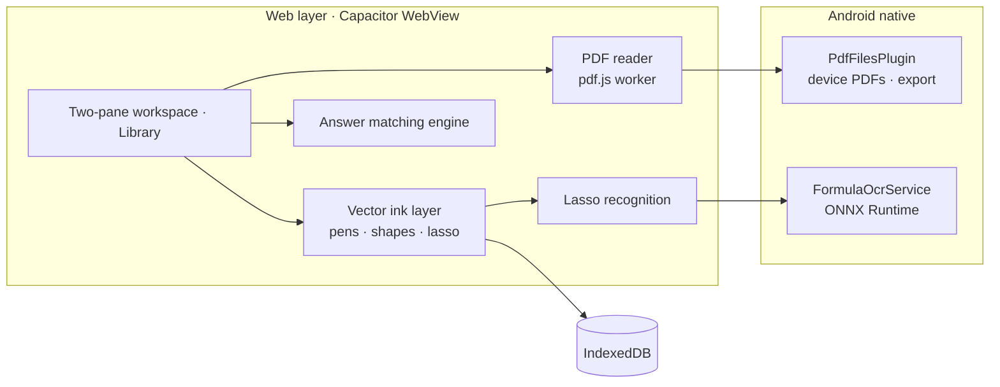

<div align="center">


# Duiye · 对页

**Handwritten textbook annotation, with the answers found for you**

Open an exercise book and its answer key side by side and write straight onto the PDF with a stylus;<br>
whichever question you are on, the engine finds which page, and where on it, the answer is.

<p>
  <a href="CHANGELOG.md"></a>
  <a href="docs/android-development.md"></a>
  <a href="LICENSE"></a>
  <a href="#privacy-and-permissions"></a>
  <a href="#development"></a>
</p>

[简体中文](README.md) · English

</div>

<p align="center">
  
</p>

<br>

<table>
<tr>
<td width="33%" valign="top">

### Questions and answers, side by side

Questions on the left, answers on the right. The matching engine works out from bookmarks, tables of contents and body text which answer belongs to which question. Until the two books are confirmed to belong together it only says "please check" — it never guesses.

</td>
<td width="33%" valign="top">

### Write on the book

Pen, pencil, marker, highlighter, shapes and lasso. Ink is vector, stored per page, and never touches the original file; on export it is drawn on top of the original pages, so the printed text stays selectable and searchable.

</td>
<td width="33%" valign="top">

### Everything stays on the device

Books, ink, scratch paper and formula recognition all live and run on the tablet. No document is ever uploaded, and it all works offline.

</td>
</tr>
</table>

## Features

### Reading and matching

- **Two-pane workspace**: drag the divider anywhere from 0:10 to 10:0; drag it all the way to collapse a pane behind a restore button. Swap the panes in one tap; widths and annotations go with them.
- **A queue in every pane**: a newly opened book or scratch pad goes in front of the current item, and the one it replaces moves underneath. Swipe up or down to switch, or tap the title to pick.
- **One book in both panes**: an exercise book with the answers at the back no longer means flipping back and forth. Each pane keeps its own page and zoom; the ink is shared, so writing on one side shows on the other at once.
- **Automatic answer matching**: question numbers on the page are listed with the location of their answers and a confidence level. On four real textbooks every one of 508 questions was resolved with zero errors. A pure scan with neither bookmarks nor a readable text layer is reported as unmatchable rather than guessed.
- **Page turns that fold**: drag a corner over; turning forward pins the left edge, turning back pins the right, and a flick counts too. Zoomed in, one finger pans instead.

### Writing

- **Five tools**: pen, pencil, marker, highlighter and eraser, with pressure, colour, width and opacity. The pencil lays down a grain of graphite, not a flat line.
- **Shapes**: ten of them, and a finished shape can still be reshaped by dragging its corners.
- **Lasso**: move, rotate and scale what you circled, recolour it, resize, copy, cut or delete it; a whole gesture is one undo step. Drag it towards the other pane and the part past the divider is drawn there live.
- **Pictures**: place a recent photo, a fresh camera shot or a gallery image on the page and write on top of it. Dragged across panes, a photo shows as a quick sketch on the far side and becomes the photo when you let go.
- **Toolbar**: park it on either side, along the bottom, in a corner or up in the top row; slide along it with one finger to change tools; optionally have it tuck itself away as soon as the pen touches the page.

### Formula recognition

Lasso a printed formula on the page (or inside a picture placed on it) and tap "Recognize". The circled area ripples like water for a moment, and then you choose what to keep:

- **Copy**: formulas are written as `$LaTeX$`, so they paste anywhere as formulas;
- **Convert to ink**: written below the circle at the printed size, and from then on it moves, scales and recolours like your own handwriting.

The model runs on the tablet (a reduced build of ONNX Runtime with a purpose-built INT8 formula model) and reads one printed formula at a time.

<p align="center">
  
</p>

> [!NOTE]
> Chinese text and running paragraphs are not recognised yet.

### Paper

- **Infinite scratch paper**: no edge in any direction, 25%–400% zoom; eight rulings (blank, dots, squares, lines, graph, isometric, tianzige, mizige) and four paper tones.
- **Notebooks**: a stack of pages you turn like a book. Set the page count when you create one and add pages at the end when it fills up; notebooks take bookmarks and export too.

<p align="center">
  
</p>

### Organising

- **Library**: books are recognised by their covers. The first slot is always the user guide.
- **Folders**: sort books when there are many; delete a folder and everything in it comes back out.
- **Combinations**: once questions are on the left and answers on the right, save the arrangement as one tile, and a tap restores both panes — pages included. You can also pick several items for each side and compose one freely.
- **Import**: every PDF on the tablet is listed, newest first, searchable and multi-selectable.
- **Bookmarks to book**: pick the pages you bookmarked and save them as a new book or export them directly; if the original gains new notes later, "Update from source" brings them over.
- **Export PDF**: ink is drawn as vectors on top of the original pages, so the text stays selectable and searchable. Notebooks and scratch pads export too, into Documents/对页.

<p align="center">
  
</p>

### Interface

- **Three skins**: Liquid Glass, Frosted Glass and Paper. Liquid Glass is a native-DOM rewrite of [liquid-glass-react](https://github.com/rdev/liquid-glass-react)'s approach.
- **The top row**: import, library, combinations and new paper on the left, "Practice / Settings" in the middle, "Close all" on the right; push it up to hand the whole screen to the books.
- **Three languages**: Simplified Chinese, Traditional Chinese, English.

## Privacy and permissions

- Books, ink, pictures, scratch pads and notebooks are stored on the tablet (IndexedDB), and formula recognition runs locally. No document is ever uploaded.
- Update checks are off by default; turn them on in Settings, or check once on demand.

> [!IMPORTANT]
> Listing every PDF on the tablet (and "Recent photos") needs the "All files access" permission: since Android 11, PDFs that other apps downloaded or saved are not media files, and without it none of them are visible. Tapping "Import" first explains what the permission is for, then takes you to the system setting. Declining is fine — "pick one with the system picker this time" is always there. The app never deletes or modifies any of your files; the only thing it writes is new files in Documents/对页 when you export.

## Install

- An Android 11 or later tablet, ideally with a stylus.
- APKs are built on demand by the "构建 APK" (Build APK) workflow in the repository's Actions, which can also publish a Release; or build one yourself as described under [Development](#development).

## Development

```bash
npm install
npm run dev              # run in the browser
npm test                 # 61 test suites, one command
npm run build:android    # build the web bundle and sync it into android/
cd android && ./gradlew assembleDebug
```

- Requires JDK 21 and Android SDK 36. A fresh clone builds as is: no submodules and no binaries to put in place by hand. If the project path on Windows contains non-ASCII characters, see [docs/BUILD_WINDOWS_NON_ASCII_PATH.md](docs/BUILD_WINDOWS_NON_ASCII_PATH.md).
- CI runs the same `npm test` on English-locale Linux with LF line endings: tests asserting Chinese UI text call `setLang('zh-CN')` first, and tests asserting on source files normalise `\r\n` to `\n`.
- The real-textbook corpus (`corpus/`) is copyrighted and not distributed with the repository; without it the related tests skip themselves. For the full regression, put the corpus at `corpus/data.json` or point `FIND_ENGINE_CORPUS` at it.
- Two more checks:

  ```bash
  npm run check:licenses   # are the dependencies that ship in the APK compatible with MIT?
  npm run check:upstream   # how many lines still come verbatim from upstream
  ```

<details>
<summary><code>check:upstream</code> needs a remote pointing at upstream</summary>

<br>

The push URL is deliberately invalid, so nothing can be pushed there by accident:

```bash
git remote add upstream https://github.com/strangelion/LaTeXSnipper_mobile.git
git remote set-url --push upstream no-push-to-upstream
git fetch upstream
```

</details>

### Technology

| Layer | What it uses |
|---|---|
| Shell | Capacitor 8 · Vite 8 (Rolldown) |
| PDF | pdf.js, rasterised in a worker on OffscreenCanvas and shown zero-copy through `bitmaprenderer` |
| Ink | A vector ink layer of its own (`src/ink/`); outlines are cached as Path2D and stored per page in IndexedDB |
| Matching | The answer matching engine — plain JavaScript, no dependencies (`src/pdf/`) |
| Recognition | ONNX Runtime 1.23.2 (reduced build) + a purpose-built formula model (`FormulaOcrService.java`); results typeset with KaTeX |
| Export | pdf-lib, run in a worker; the native side writes a hidden temporary file and renames it once complete |
| Device files | `PdfFilesPlugin.java`: lists every PDF through MediaStore, streams them in, writes exports |
| Interface | `liquid.css` owns sizes and layout, the three skins only change materials; Liquid Glass is built on SVG displacement filters |
| Storage | IndexedDB (books, ink, pictures, scratch pads, notebooks) + localStorage (session, reading positions, folders, combinations) |
| Offline | Service Worker (`public/sw.js`) |



### Experimental: 页问 (Ask the page)

A panel for asking questions about the page in front of you: answers are rendered as Markdown with KaTeX formulas, and conversations are kept per page on the device. It talks to a local development proxy ([native/agent-proxy/](native/agent-proxy/README.md)) that is not part of the Android package, so it does not work on the tablet yet.

## About the name

对页 combines two meanings of 对: **checking an answer**, and **two facing pages**. Questions on the left, answers on the right, and the engine decides which answer belongs to which question.

The icon draws the same idea: two pages side by side, a notch in the left page filled by a tab on the right, meeting along the centre line. That line is both the matching engine and the divider you drag.

## Provenance and licence

Duiye is released under the **MIT** licence; see [LICENSE](LICENSE).

- **The application** began as a fork of [strangelion/LaTeXSnipper_mobile](https://github.com/strangelion/LaTeXSnipper_mobile) and inherited its AGPL-3.0. After its core was rewritten in full, the project moved to MIT; every revision before the cut-over is still governed by AGPL-3.0, whose text is kept in [LICENSE.AGPL-3.0](LICENSE.AGPL-3.0), and history has not been rewritten. Where the cut-over is and why it is valid: [docs/许可证变更.md](docs/许可证变更.md); how far the upstream clean-up has gone: [docs/上游代码清理.md](docs/上游代码清理.md). Upstream's recognition, formula editor and model management have all been removed; today's formula recognition is a separate, purpose-built model added by this project.
- **The answer matching engine** comes from [LZY0105/Math-answer-to-question-matching-model](https://github.com/LZY0105/Math-answer-to-question-matching-model) (MIT). The 21 modules under `src/pdf/` are kept in step with its `main` branch (last synced at `7673a20`), and the engine's own regression tests are ported into `test/`.
- **Formula recognition** runs on [ONNX Runtime](https://github.com/microsoft/onnxruntime) 1.23.2 (MIT, © Microsoft Corporation). The formula model was trained from scratch for this project; its provenance is recorded in `ocr/MODEL_CARD.md` of the matching-engine repository.
- **Liquid Glass** uses three displacement maps taken unchanged from [rdev/liquid-glass-react](https://github.com/rdev/liquid-glass-react) (MIT, © 2025 Max Rovensky); the licence notice is kept in `src/ui/liquid-glass-maps.js`.
- **The 页问 panel and the local proxy** were written by [@allnothing571](https://github.com/allnothing571), who holds their copyright.

The full third-party notices are in [THIRD_PARTY_NOTICES.md](THIRD_PARTY_NOTICES.md). `npm run check:licenses` keeps watch: every dependency that ships in the APK has to be compatible with MIT, so copyleft code such as GPL or AGPL cannot come in.

## Documentation

| Document | What it covers |
|---|---|
| [CHANGELOG.md](CHANGELOG.md) | Version history |
| [docs/android-development.md](docs/android-development.md) | Android development and builds |
| [docs/tablet-acceptance.md](docs/tablet-acceptance.md) | On-tablet acceptance checklist |
| [docs/待实机验证.md](docs/待实机验证.md) | What each change was verified for on the tablet, and what is still open (Chinese) |
| [docs/OCR接入说明.md](docs/OCR接入说明.md) | Lasso recognition: the interface, the engine contract, converting to ink (Chinese) |
| [docs/许可证变更.md](docs/许可证变更.md) | The move from AGPL-3.0 to MIT (Chinese) |
| [docs/上游代码清理.md](docs/上游代码清理.md) | What remains from upstream and why the clean-up stops there (Chinese) |
| [SECURITY.md](SECURITY.md) | How to report a security issue |
