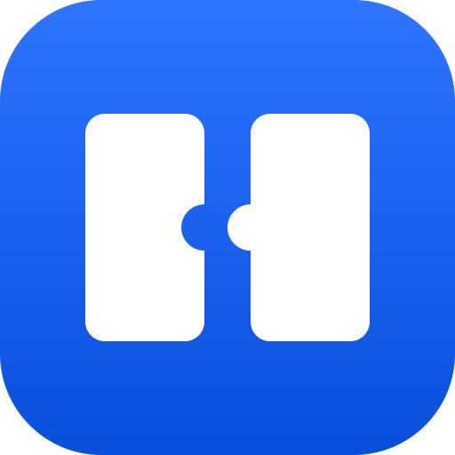
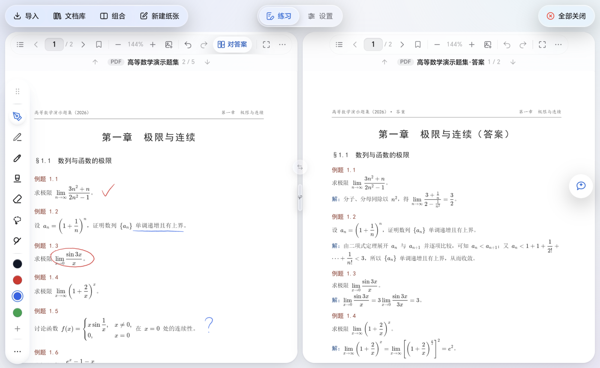
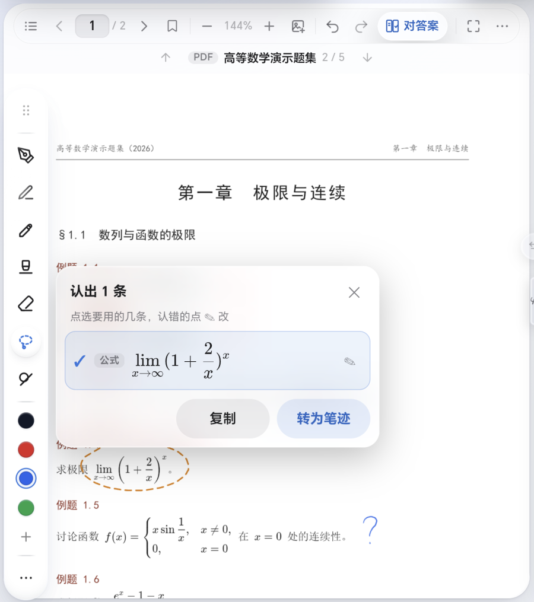
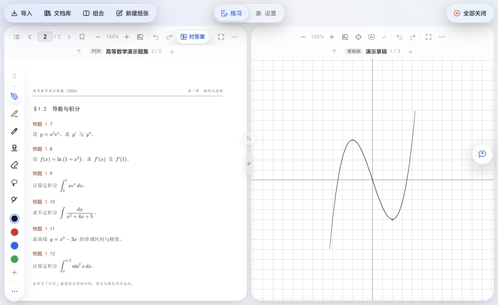
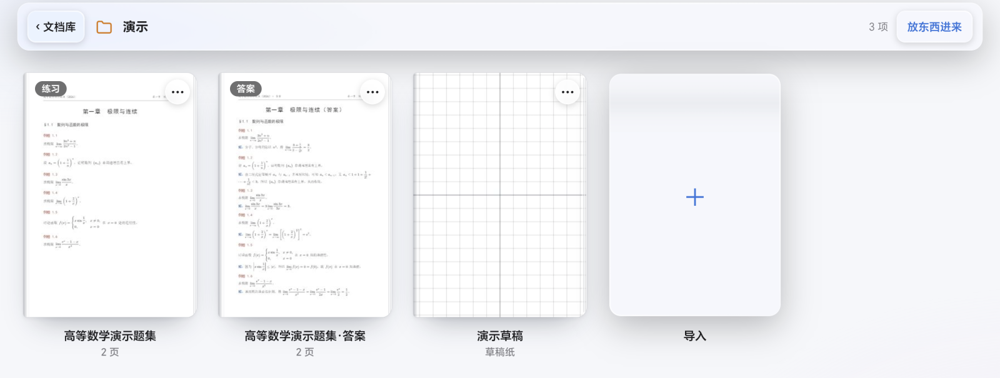
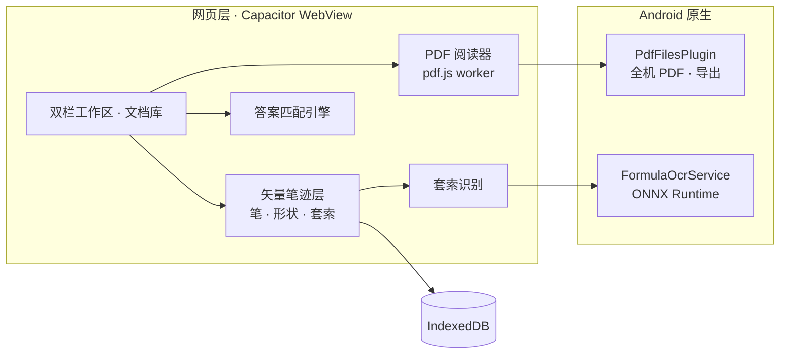

<div align="center">



# 对页

**教材手写批注与对题**

练习册和答案册并排打开，用触控笔直接写在 PDF 上；<br>
翻到哪一题，引擎就替你找出它的答案在哪一页、哪一处。

<p>
  <a href="CHANGELOG.md"></a>
  <a href="docs/android-development.md"></a>
  <a href="LICENSE"></a>
  <a href="#隐私与权限"></a>
  <a href="#开发"></a>
</p>

简体中文 · [English](README.en.md)

</div>

<p align="center">
  
</p>

<br>

<table>
<tr>
<td width="33%" valign="top">

### 同屏对题

左边一页题，右边一页答案。匹配引擎从书签、目录和正文里认出哪一条答案对应哪一题；两本书还没确认配套时，它只提示「请核对」，不会硬凑一个答案。

</td>
<td width="33%" valign="top">

### 写在书上

钢笔、铅笔、马克笔、荧光笔、形状、套索。笔迹是矢量的，按页保存，从不改动原文件；导出时叠加在原页上，书上的文字照样能选、能搜。

</td>
<td width="33%" valign="top">

### 全在本机

书、笔迹和草稿都存在平板上，公式识别也在本机完成；不上传任何文档，没有网络也照常能用。

</td>
</tr>
</table>

## 功能

### 读书与对题

- **双栏工作区**：分隔条可以在 0:10 到 10:0 之间随手拖，拖到底就收起那一栏，只留一个恢复按钮；两栏能一键互换，宽度和批注跟着一起换。
- **每栏一摞内容**：新开的书或草稿纸放在当前那一份上面，原来那一份压到下层；上下滑动切换，也可以点标题直接挑。
- **同一本书开在两栏**：题在前、答案在后的习题册，不用再来回翻。两边各记各的页码和缩放，笔迹共用一份，一边写，另一边立刻跟着变。
- **自动对题**：按页列出题号和对应答案的位置，并标出可靠度。在四本真实的考研教材上，508 道题全部配上、零错误；既没有书签、也没有可读文字层的纯扫描件，会直接告诉你没法匹配，不去瞎猜。
- **翻页像折纸**：拖着页角翻过去，往后翻固定左边、往前翻固定右边，甩一下也算；放大以后，一根手指拖动就是移动页面。

### 书写

- **四种笔和橡皮**：钢笔、铅笔、马克笔、荧光笔，外加橡皮；压感、颜色、粗细、不透明度都能调。铅笔画出来带着石墨的颗粒感，不是一条均匀的线。
- **形状**：十种形状，画完以后点一下，还能拖动顶点修改。
- **套索**：圈住以后可以移动、旋转、缩放，也可以换色、调大小、复制、剪切、删除；一次完整的手势只算一步撤销。拖向另一栏时，越过分隔条的那一截当场就画到对面。
- **插入图片**：从最近的照片、相机或图库里挑一张贴到页上，可以直接在图上写字；跨栏拖动照片时，对面先显示一张简笔画，松手后才换成照片。
- **工具栏**：可以停在左右两边、底边、角落或顶上那一排；按住一支笔顺着工具栏划过去就能换笔；也可以设成一落笔就自动收起。

### 识别公式

用套索圈住书上印的公式（页上贴的图片里的也行），点「识别」，圈里的内容会像水面一样起伏；认出来以后，挑几条结果：

- **复制**：以 `$LaTeX$` 的形式复制，粘到别处还是公式；
- **转为笔迹**：按书上的大小写在圈的下方，和手写的一样能拖、能缩放、能换色。

模型在平板上运行（ONNX Runtime 精简构建加一个自建的 INT8 公式模型），一次识别一个印刷体公式。

<p align="center">
  
</p>

> [!NOTE]
> 暂时还识别不了中文和成段的文字。

### 纸

- **无限草稿纸**：四个方向都没有边界，能在 25%–400% 之间缩放；有八种底纹（空白、点阵、方格、横线、坐标格、等距斜格、田字格、米字格）和四种纸色。
- **笔记本**：一页一页翻的本子，新建时定好页数，写满了可以在末尾加页；能加书签，也能导出。

<p align="center">
  
</p>

### 整理

- **文档库**：每本书以封面展示，第一格始终是使用说明。
- **文件夹**：书多了可以分门别类；删掉文件夹，里面的书一本不少地回到外面。
- **组合**：把摆好的两栏（比如题在左、答案在右）存成一格，点一下，两栏连同页码一起恢复；也可以左右各挑几份，自由拼一套。
- **导入**：列出平板上所有的 PDF，按时间排序，可以搜名字，也能多选。
- **书签成书**：把标过书签的页挑出来，存成一本新书或直接导出；原书后来又添了批注，可以用「从母本更新」同步过来。
- **导出 PDF**：笔迹以矢量形式叠加在原页上，文字照样能选、能搜；笔记本和草稿纸也能导出，文件存进「文档/对页」。

<p align="center">
  
</p>

### 界面

- **三套皮肤**：液态玻璃、毛玻璃、纸。液态玻璃参照 [liquid-glass-react](https://github.com/rdev/liquid-glass-react) 的做法，用原生 DOM 重写。
- **顶上那一排**：左边是导入、文档库、组合、新建纸张，正中是「练习 / 设置」，右边是「全部关闭」；往上一推就收起，把整屏留给书。
- **三种语言**：简体中文、繁體中文、English。

## 隐私与权限

- 书、笔迹、图片、草稿纸、笔记本都存在平板上（IndexedDB），公式识别也在本机运行，不上传任何文档。
- 检查更新默认关闭：可以在设置里打开，也可以需要时手动查一次。

> [!IMPORTANT]
> 列出平板上所有的 PDF（还有「最近照片」）需要「所有文件访问权限」：从 Android 11 起，其他应用下载或保存的 PDF 不算媒体文件，没有这个权限一份都看不到。点「导入」时，会先说明这个权限用来做什么，再带你去系统设置里打开。不给也照样能用：「这次用系统选择器选一份」一直都在。应用不会删除或修改你的任何文件，唯一会写入的，是导出时在「文档/对页」里新建的文件。

## 安装

- 一台 Android 11 及以上的平板，最好有触控笔。
- 安装包由仓库 Actions 里的「构建 APK」工作流手动构建，可以顺带发布一个 Release；也可以按下面「开发」一节自己编译。

## 开发

```bash
npm install
npm run dev              # 在浏览器里跑
npm test                 # 61 组测试，一条命令
npm run build:android    # 打网页包并同步进 android/
cd android && ./gradlew assembleDebug
```

- 需要 JDK 21、Android SDK 36。全新 clone 下来就能直接编译，不需要子模块，也不用手动放任何二进制文件。Windows 上工程路径含中文的，见 [docs/BUILD_WINDOWS_NON_ASCII_PATH.md](docs/BUILD_WINDOWS_NON_ASCII_PATH.md)。
- CI 在英文、LF 换行的 Linux 上跑同一条 `npm test`：断言中文文案的测试要先 `setLang('zh-CN')`，拿源码做断言的要先把 `\r\n` 换成 `\n`。
- 真实教材语料（`corpus/`）有版权，不随仓库分发；缺了它，相关测试自动跳过。要跑全量回归，把语料放在 `corpus/data.json`，或者用环境变量 `FIND_ENGINE_CORPUS` 指向它。
- 另有两个检查：

  ```bash
  npm run check:licenses   # 会打进 APK 的依赖，许可证是否与 MIT 相容
  npm run check:upstream   # 还有多少行逐字来自上游
  ```

<details>
<summary><code>check:upstream</code> 需要一个指向上游的远端</summary>

<br>

push 地址故意设成无效值，免得手滑推过去：

```bash
git remote add upstream https://github.com/strangelion/LaTeXSnipper_mobile.git
git remote set-url --push upstream no-push-to-upstream
git fetch upstream
```

</details>

### 技术栈

| 层 | 用的是 |
|---|---|
| 外壳 | Capacitor 8 · Vite 8（Rolldown） |
| PDF | pdf.js，在 worker 里用 OffscreenCanvas 栅格化，`bitmaprenderer` 零拷贝上屏 |
| 笔迹 | 自研矢量墨迹层（`src/ink/`），轮廓存成 Path2D，按页存进 IndexedDB |
| 对题 | 答案匹配引擎，纯 JavaScript、无依赖（`src/pdf/`） |
| 识别 | ONNX Runtime 1.23.2 精简构建 + 自建公式模型（`FormulaOcrService.java`），结果用 KaTeX 排 |
| 导出 | pdf-lib，在 worker 里做；原生层先写隐藏的临时文件，写完再改名 |
| 本机文件 | `PdfFilesPlugin.java`：查 MediaStore 列出全机 PDF，流式读入，写出导出的文件 |
| 界面 | `liquid.css` 管尺寸和版式，三套皮肤只换材质；液态玻璃靠 SVG 位移滤镜 |
| 存储 | IndexedDB（书、笔迹、图片、草稿纸、笔记本）＋ localStorage（会话、阅读位置、文件夹、组合） |
| 离线 | Service Worker（`public/sw.js`） |



### 实验中：页问

针对当前这一页提问的面板：回答按 Markdown 排版，公式用 KaTeX 渲染，对话按页保存在本机。它需要连一个开发用的本机代理（[native/agent-proxy/](native/agent-proxy/README.md)），安卓安装包里不带这个代理，所以平板上暂时还用不了。

## 关于名字

「对页」有两层意思：**对答案**，和**对开的两页**。左边一页题，右边一页答案，由引擎判断哪一条对应哪一题。

图标用几何图形表达同一个意思：两页并排，左页缺一个口，右页凸出的一块正好补上，在中线处咬合。那条中线既代表匹配引擎，也是你会拖动的那条分隔条。

## 来源与许可

对页以 **MIT** 发布，见 [LICENSE](LICENSE)。

- **应用主体**最初从 [strangelion/LaTeXSnipper_mobile](https://github.com/strangelion/LaTeXSnipper_mobile) 分出，继承了它的 AGPL-3.0。核心部分整体重写之后改为 MIT；分界点之前的每一个版本仍然适用 AGPL-3.0，原文保留在 [LICENSE.AGPL-3.0](LICENSE.AGPL-3.0)，历史没有被改写。分界点在哪、为什么可以改，见 [docs/许可证变更.md](docs/许可证变更.md)；上游代码清理到了哪一步，见 [docs/上游代码清理.md](docs/上游代码清理.md)。上游的识别、公式编辑器、模型管理都已移除，现在的公式识别用的是本项目自建的模型。
- **答案匹配引擎**来自 [LZY0105/Math-answer-to-question-matching-model](https://github.com/LZY0105/Math-answer-to-question-matching-model)（MIT）。`src/pdf/` 下的 21 个模块与它的 `main` 分支保持一致（最近一次同步到 `7673a20`），引擎自带的回归测试也移植到了 `test/`。
- **公式识别**跑在 [ONNX Runtime](https://github.com/microsoft/onnxruntime) 1.23.2 上（MIT，© Microsoft Corporation）；公式模型由本项目从头训练，来历见匹配引擎仓库里的 `ocr/MODEL_CARD.md`。
- **液态玻璃**的三张位移贴图原样取自 [rdev/liquid-glass-react](https://github.com/rdev/liquid-glass-react)（MIT，© 2025 Max Rovensky），许可声明保留在 `src/ui/liquid-glass-maps.js`。
- **页问面板与本机代理**由 [@allnothing571](https://github.com/allnothing571) 编写，著作权归作者本人。

完整的第三方声明见 [THIRD_PARTY_NOTICES.md](THIRD_PARTY_NOTICES.md)。`npm run check:licenses` 负责把关：每一个会打进 APK 的依赖都必须与 MIT 相容，GPL / AGPL 这类 copyleft 代码进不来。

## 文档

| 文档 | 讲什么 |
|---|---|
| [CHANGELOG.md](CHANGELOG.md) | 版本变更 |
| [docs/android-development.md](docs/android-development.md) | Android 开发与构建 |
| [docs/tablet-acceptance.md](docs/tablet-acceptance.md) | 平板真机验收清单 |
| [docs/待实机验证.md](docs/待实机验证.md) | 每一处改动在平板上验过什么、还差什么 |
| [docs/OCR接入说明.md](docs/OCR接入说明.md) | 套索「识别」：界面、引擎接口、转成笔迹 |
| [docs/许可证变更.md](docs/许可证变更.md) | 从 AGPL-3.0 改为 MIT 的分界与判据 |
| [docs/上游代码清理.md](docs/上游代码清理.md) | 上游代码还剩什么、为什么不再往下清 |
| [SECURITY.md](SECURITY.md) | 安全问题怎么报 |
