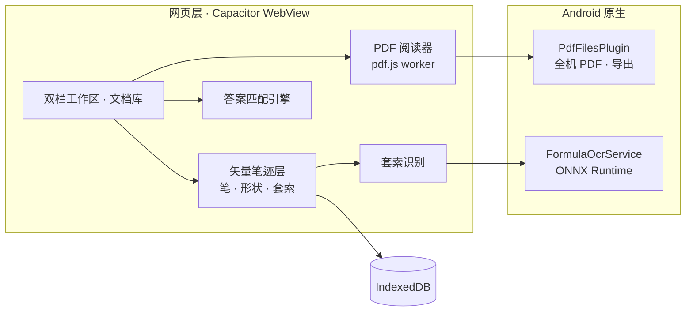

<div align="center">


# 对页

**教材手写批注与对题**

练习册和答案册并排打开，用触控笔直接写在 PDF 上；<br>
翻到哪一题，答案在哪一页、哪一处，引擎替你找出来。

<p>
  <a href="CHANGELOG.md"></a>
  <a href="docs/android-development.md"></a>
  <a href="LICENSE"></a>
  <a href="#隐私与权限"></a>
  <a href="#开发"></a>
</p>

简体中文 · [English](README.en.md)

</div>

<br>

<table>
<tr>
<td width="33%" valign="top">

### 同屏对题

左边一页题，右边一页答案。匹配引擎从书签、目录和正文里认出哪一条答案对应哪一题；两本书没确认配套之前，它只说「请核对」，不硬给。

</td>
<td width="33%" valign="top">

### 写在书上

钢笔、铅笔、马克笔、荧光笔、形状、套索。笔迹是矢量，按页存，从不改动原文件；导出时加画在原页上，书上的字照样能选、能搜。

</td>
<td width="33%" valign="top">

### 全在本机

书、笔迹、草稿和公式识别都在平板上完成，不上传任何文档，没有网络也照常能用。

</td>
</tr>
</table>

## 功能

### 读书与对题

- **双栏工作区**：分隔条在 0:10 到 10:0 之间随手拖，拖到底就收起那一栏、留一个恢复按钮；左右一键互换，宽度和批注跟着走。
- **每栏一队内容**：新开的书或草稿纸插在当前那一份前面，换下来的转到下层，上滑、下滑切换，点标题直接挑。
- **同一本书开在两栏**：题在前、答案在后的习题册不用来回翻。两边各记各的页码和缩放，笔迹是同一份，一边写另一边立刻跟着变。
- **自动对题**：按页列出题号和对应答案的位置，并标出可靠度。四本真实考研教材上 508/508 全部解析、零错误；没有书签、也没有可读文字层的纯扫描件，会直接说没法匹配，不去猜。
- **翻页像折纸**：拖着页角翻过去，往后翻固定左边、往前翻固定右边，甩一下也算；放大以后一根手指改成拖着看。
- **放大缩小不卡**：PDF 在独立线程里栅格化，最近几页留着不丢；捏合时书页先按比例拉着，笔迹始终清晰，手停下来再按真实大小重画。

### 书写

- **五种笔**：钢笔、铅笔、马克笔、荧光笔、橡皮，压感、颜色、粗细、不透明度都能调。铅笔画出来是一层石墨颗粒，不是一条均匀的线。
- **形状**：十种形状，画完点一下还能拖着顶点改。
- **套索**：圈住就能移动、旋转、缩放，换色、调大小、复制、剪切、删除，一整段手势只占一步撤销。拖向另一栏时，越过分隔条的那一截当场画在对面。
- **插入图片**：从最近照片、拍照或图库挑一张贴在页上，字写在图的上面；照片跨栏拖动时对面先画一张简笔画，松手才换成照片。
- **工具栏**：停在左右、底边、角落或顶上那一排都行；按住一支笔顺着工具栏划过去就能换；可以设成一落笔就自己收起。
- **只认笔写字**：触控笔写字，手指和鼠标翻页、平移；手掌搭在屏幕上不会选中文字、弹出菜单。

### 识别公式

套索圈一块书上印的公式（贴在页上的图片里的也行），点「识别」，圈里的东西像水面一样起伏一下，认出来以后挑几条：

- **复制**：公式写成 `$LaTeX$`，粘到别处还是公式；
- **转为笔迹**：照书上那么大写在圈的下面，和自己写的一样能拖、能缩放、能换色。

模型在平板上跑：ONNX Runtime 精简构建加一个自建的 INT8 公式模型（4 MB 多），一次认一个印刷公式，几百毫秒出结果。

> [!NOTE]
> 中文和成段的文字暂时还认不了。

### 纸

- **无限草稿纸**：四个方向都没有边，缩放 25%–400%；八种底纹（空白、点阵、方格、横线、坐标格、等距斜格、田字格、米字格）、四种纸色。
- **笔记本**：一页一页翻的本子，新建时定页数，写满了在末尾加页；能记书签，也能导出。

### 整理

- **文档库**：按封面认书，第一格永远是使用说明。
- **文件夹**：书多了分一分；删掉文件夹，里面的书一本不少地回到外面。
- **组合**：题在左、答案在右摆好了，存成一格，点一下两栏连同页码一起摆回来；也可以左右各挑几份自由拼。
- **导入**：列出平板上所有的 PDF，按时间排、能搜名字、能多选；几百兆的大书也是几秒就读进来。
- **书签成书**：把标过书签的页挑出来，存成一本新书或直接导出；原书后来又写了批注，可以「从母本更新」。
- **导出 PDF**：笔迹以矢量加画在原页上，文字照样能选、能搜；笔记本和草稿纸也能导，存进「文档/对页」。

### 界面

- **三套皮肤**：液态玻璃、毛玻璃、纸。液态玻璃照 [liquid-glass-react](https://github.com/rdev/liquid-glass-react) 的做法重写成原生 DOM；三套共用一份尺寸，换皮肤一个像素都不挪。
- **顶上那一排**：左边导入、文档库、组合、新建纸张，正中「练习 / 设置」，右边「全部关闭」；往上一推就收起，把整屏让给书。
- **三种语言**：简体中文、繁體中文、English。
- **无障碍**：降低透明度、提高对比度、减少动态效果都照顾到。

## 隐私与权限

- 书、笔迹、图片、草稿纸、笔记本都存在平板上（IndexedDB），公式识别也在本机跑，不上传任何文档。
- 检查更新默认关闭，要用时在设置里打开，或者按一次查一次。

> [!IMPORTANT]
> 列出平板上所有的 PDF（还有「最近照片」）需要「所有文件访问权限」：从 Android 11 起，别的应用下载、存下的 PDF 不算媒体文件，没有这个权限就一份都看不到。点「导入」时会先说清楚要它做什么，再带你去系统设置里打开。不给也照样能用：「这次用系统选择器选一份」一直都在。应用不会删除或修改你的任何文件，唯一会写的，是导出时在「文档/对页」里新建文件。

## 安装

- 一台 Android 11 及以上的平板，最好有触控笔。
- 安装包由仓库 Actions 里的「构建 APK」工作流手动出，可以同时发一个 Release；也可以照下面「开发」一节自己编。

## 开发

```bash
npm install
npm run dev              # 在浏览器里跑
npm test                 # 61 组测试，一条命令
npm run build:android    # 打网页包并同步进 android/
cd android && ./gradlew assembleDebug
```

- 需要 JDK 21、Android SDK 36。全新 clone 就能直接编，不用子模块，也不用手工放任何二进制。Windows 上工程路径带中文的，看 [docs/BUILD_WINDOWS_NON_ASCII_PATH.md](docs/BUILD_WINDOWS_NON_ASCII_PATH.md)。
- CI 在英文、LF 换行的 Linux 上跑同一条 `npm test`：断言中文文案的测试先 `setLang('zh-CN')`，拿源码做断言的先把 `\r\n` 换成 `\n`。
- 真实教材语料（`corpus/`）有版权，不随仓库分发；缺了它，相关测试自动跳过。要跑全量回归，把语料放在 `corpus/data.json`，或者用 `FIND_ENGINE_CORPUS` 指过去。
- 另有两个检查：

  ```bash
  npm run check:licenses   # 会打进 APK 的依赖，许可证和 MIT 相不相容
  npm run check:upstream   # 还有多少行逐字来自上游
  ```

<details>
<summary><code>check:upstream</code> 需要一个指向上游的远端</summary>

<br>

push 地址故意设成无效值，免得手滑推过去：

```bash
git remote add upstream https://github.com/strangelion/LaTeXSnipper_mobile.git
git remote set-url --push upstream no-push-to-upstream
git fetch upstream
```

</details>

### 技术栈

| 层 | 用的是 |
|---|---|
| 外壳 | Capacitor 8 · Vite 8（Rolldown） |
| PDF | pdf.js，在 worker 里用 OffscreenCanvas 栅格化，`bitmaprenderer` 零拷贝上屏 |
| 笔迹 | 自研矢量墨迹层（`src/ink/`），轮廓存成 Path2D，按页存进 IndexedDB |
| 对题 | 答案匹配引擎，纯 JavaScript、无依赖（`src/pdf/`） |
| 识别 | ONNX Runtime 1.23.2 精简构建 + 自建公式模型（`FormulaOcrService.java`），结果用 KaTeX 排 |
| 导出 | pdf-lib，在 worker 里做；原生那边先写隐藏的临时文件，写完再改名 |
| 本机文件 | `PdfFilesPlugin.java`：查 MediaStore 列出全机 PDF、流式读进来、写导出 |
| 界面 | `liquid.css` 管尺寸和版式，三套皮肤只换材质；液态玻璃靠 SVG 位移滤镜 |
| 存储 | IndexedDB（书、笔迹、图片、草稿纸、笔记本）＋ localStorage（会话、阅读位置、文件夹、组合） |
| 离线 | Service Worker（`public/sw.js`） |



### 实验中：页问

对着当前这一页提问的面板：回答按 Markdown 排版、公式用 KaTeX 渲染，对话按页记在本机。它要连一个开发用的本机代理（[native/agent-proxy/](native/agent-proxy/README.md)），安卓安装包里没有这个代理，所以平板上暂时还用不了。

## 关于名字

「对页」取两层意思：**对答案**，和**对开的两页**。左边一页题，右边一页答案，由引擎判断哪一条对应哪一题。

图标是同一个想法的几何写法：两页并排，左页缺一个口，右页凸出正好补上，在中线咬合。那条中线既是匹配引擎，也是你会去拖动的那条分隔条。

## 来源与许可

对页以 **MIT** 发布，见 [LICENSE](LICENSE)。

- **应用主体**最初从 [strangelion/LaTeXSnipper_mobile](https://github.com/strangelion/LaTeXSnipper_mobile) 分出，继承了它的 AGPL-3.0。核心部分整体重写之后改为 MIT；分界点之前的每一个版本仍然适用 AGPL-3.0，原文保留在 [LICENSE.AGPL-3.0](LICENSE.AGPL-3.0)，历史没有被改写。分界在哪、凭什么能改，见 [docs/许可证变更.md](docs/许可证变更.md)；上游代码清理到了哪一步，见 [docs/上游代码清理.md](docs/上游代码清理.md)。上游的识别、公式编辑器、模型管理都已移除，现在的公式识别是本项目另外接上的自建模型。
- **答案匹配引擎**来自 [LZY0105/Math-answer-to-question-matching-model](https://github.com/LZY0105/Math-answer-to-question-matching-model)（MIT）。`src/pdf/` 下的 21 个模块与它的 `main` 分支保持一致（最近一次同步到 `7673a20`），引擎自带的回归测试也移植到了 `test/`。
- **公式识别**跑在 [ONNX Runtime](https://github.com/microsoft/onnxruntime) 1.23.2 上（MIT，© Microsoft Corporation）；公式模型由本项目从头训练，来历见匹配引擎仓库里的 `ocr/MODEL_CARD.md`。
- **液态玻璃**的三张位移贴图原样取自 [rdev/liquid-glass-react](https://github.com/rdev/liquid-glass-react)（MIT，© 2025 Max Rovensky），许可声明保留在 `src/ui/liquid-glass-maps.js`。
- **页问面板与本机代理**由 [@allnothing571](https://github.com/allnothing571) 所写，著作权归作者本人。

完整的第三方声明见 [THIRD_PARTY_NOTICES.md](THIRD_PARTY_NOTICES.md)。`npm run check:licenses` 守着：每一个会打进 APK 的依赖都要和 MIT 相容，GPL / AGPL 这类 copyleft 代码进不来。

## 文档

| 文档 | 讲什么 |
|---|---|
| [CHANGELOG.md](CHANGELOG.md) | 版本变更 |
| [docs/android-development.md](docs/android-development.md) | Android 开发与构建 |
| [docs/tablet-acceptance.md](docs/tablet-acceptance.md) | 平板真机验收清单 |
| [docs/待实机验证.md](docs/待实机验证.md) | 每一处改动在平板上验过什么、还差什么 |
| [docs/OCR接入说明.md](docs/OCR接入说明.md) | 套索「识别」：界面、引擎接口、转成笔迹 |
| [docs/许可证变更.md](docs/许可证变更.md) | 从 AGPL-3.0 改为 MIT 的分界与判据 |
| [docs/上游代码清理.md](docs/上游代码清理.md) | 上游代码还剩什么、为什么不再往下清 |
| [SECURITY.md](SECURITY.md) | 安全问题怎么报 |
